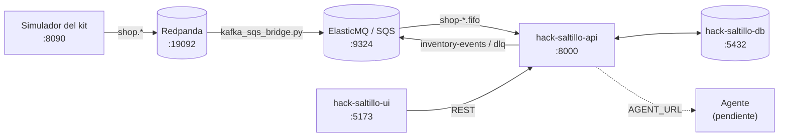
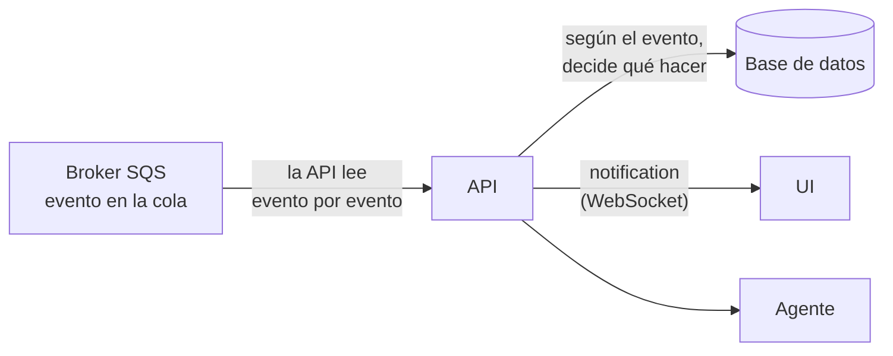
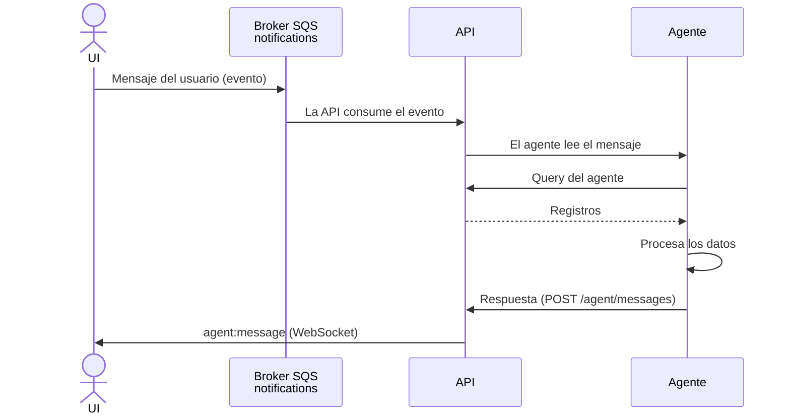
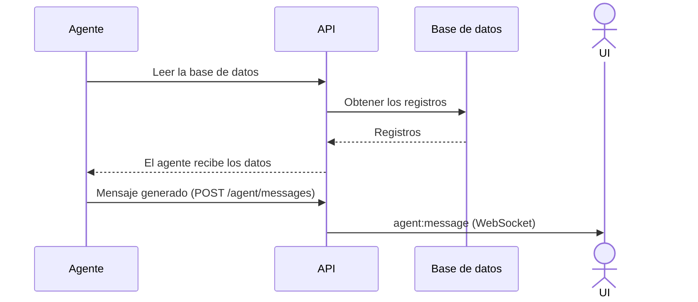

# Hack Saltillo API

API de inventario de **Roceel**, nuestra solución al reto *Almacén inteligente para taller* (HackITS
2026). Consume los eventos del taller desde AWS SQS, los guarda y proyecta en PostgreSQL (libro mayor de
existencias, reservas, faltantes y reabasto), publica sus propios eventos de inventario, expone una API
REST para la UI y el agente, y es el servidor de WebSocket para avisar de los cambios en tiempo real.

- **Framework:** NestJS 12 (TypeScript, ESM) y TypeORM.
- **Broker:** AWS SQS (colas FIFO), con ElasticMQ en local.
- **Base de datos:** PostgreSQL. El esquema lo crea Liquibase en `hack-saltillo-db`; la API no crea ni altera tablas.
- **Estado:** las pruebas de contrato del kit dan **50 / 50** en local, con reconstrucción y validación de
  todas las salidas contra el contrato (10 oct 2026, commit `ffc566d`). Detalle en
  [`RESULTADOS-PRUEBAS.md`](https://github.com/AgustinReyesC/hack-saltillo-ui/blob/main/docs/RESULTADOS-PRUEBAS.md).
- **Diseño:** [docs/API Design.md](docs/API%20Design.md) y la guía de construcción
  [docs/API README.md](docs/API%20README.md).

## Contenido

1. [El sistema completo](#el-sistema-completo)
2. [Levantar todo el sistema en local](#levantar-todo-el-sistema-en-local)
3. [Correr la API en local](#correr-la-api-en-local)
4. [Conectar con los demás repos](#conectar-con-los-demás-repos)
5. [Scripts](#scripts)
6. [Variables de entorno](#variables-de-entorno)
7. [Flujo de información](#flujo-de-información)
8. [Colas SQS](#colas-sqs)
9. [Procesamiento de eventos](#procesamiento-de-eventos)
10. [Eventos de salida](#eventos-de-salida)
11. [Rutas HTTP](#rutas-http)
12. [WebSocket](#websocket)
13. [Convenciones de la API](#convenciones-de-la-api)
14. [Pruebas](#pruebas)
15. [Despliegue en AWS](#despliegue-en-aws)

## El sistema completo

| Repo | Qué hace | En local |
|---|---|---|
| [`hack-saltillo-db`](https://github.com/AgustinReyesC/hack-saltillo-db) | PostgreSQL 16: esquema, migraciones (Liquibase) y catálogo semilla. | `localhost:5432` |
| [`hack-saltillo-broker`](https://github.com/AgustinReyesC/hack-saltillo-broker) | Colas SQS FIFO: Terraform para AWS y ElasticMQ para local. | `localhost:9324` |
| **`hack-saltillo-api`** (este) | Servicio de inventario: consume las colas, lleva el libro mayor, publica `stock.*` y expone REST y WebSocket. | `localhost:8000` (HTTP), `:8443` (HTTPS) |
| [`hack-saltillo-ui`](https://github.com/AgustinReyesC/hack-saltillo-ui) | Pantallas (React + Vite): dashboard, piso con escaneo, órdenes y resolución. | `localhost:5173` |
| [`hack-saltillo-events`](https://github.com/AgustinReyesC/hack-saltillo-events) | Prototipo del agente de IA (Gemini). Aún no se conecta a la API. | proceso de consola |
| `hackathon-inventario-kit` | Kit del reto (no es repo del equipo): Redpanda, simulador, contrato y pruebas de contrato. | `:19092` Kafka, `:8080` consola, `:8090` simulador |



El simulador y las pruebas de contrato del kit solo hablan **Kafka**; la API solo habla **SQS**. En local los
une el puente `kafka_sqs_bridge.py`, que hoy está en la copia local del kit
(`hackathon-inventario-kit/pruebas-locales/`) y no está versionado en ningún repo del equipo. Sin el puente,
la API no recibe nada del simulador ni de las pruebas.

## Levantar todo el sistema en local

Todo corre en tu máquina, sin recursos de AWS. Clona los repos como carpetas hermanas, junto al kit:

```text
HackITS 2026/
├── hack-saltillo-api/
├── hack-saltillo-broker/
├── hack-saltillo-db/
├── hack-saltillo-events/
├── hack-saltillo-ui/
└── hackathon-inventario-kit/     kit del reto
```

Requisitos: Docker con Compose v2, Node.js 24.15 o superior, y Python 3.10+ con
`pip install confluent-kafka boto3` para el puente.

1. **Base de datos** (`hack-saltillo-db`):

   ```bash
   cp .env.example .env
   docker compose up -d
   ```

2. **SQS local** (`hack-saltillo-broker`). Solo `elasticmq`: su Redpanda chocaría con el del kit.

   ```bash
   docker compose up -d elasticmq
   ```

3. **Kafka del kit y sus tópicos** (`hackathon-inventario-kit`):

   ```bash
   docker compose up -d redpanda console
   docker compose exec redpanda rpk topic create shop.catalog shop.work_orders shop.inspections shop.purchasing inventory.events inventory.dlq -p 3
   ```

4. **Puente Kafka ↔ SQS** (`hackathon-inventario-kit/pruebas-locales`, en su propia terminal). Al arrancar
   crea las 7 colas en ElasticMQ:

   ```bash
   python -u kafka_sqs_bridge.py
   ```

5. **API** (este repo, en su propia terminal), con el `.env.local` de
   [Correr la API en local](#correr-la-api-en-local):

   ```bash
   npm install
   npm run start:dev
   ```

6. **Simulador** (`hackathon-inventario-kit`). Reproduce seis semanas del taller en unos 17 minutos
   (`SPEED=0` sin pausas). Arráncalo con la API ya corriendo, para que las compras lleguen después de las
   inspecciones como en el taller:

   ```bash
   docker compose up -d simulator
   ```

7. **UI** (`hack-saltillo-ui`, en su propia terminal), con `VITE_USE_MOCKS=false` en su `.env.local`
   (ver [su README](https://github.com/AgustinReyesC/hack-saltillo-ui#conectar-con-la-api-local)):

   ```bash
   npm install
   npm run dev
   ```

| Qué | Dónde |
|---|---|
| UI | http://localhost:5173 |
| API | http://localhost:8000/health |
| Panel del simulador (abrir órdenes, aprobar inspecciones, recibir compras) | http://localhost:8090 |
| Consola de Redpanda (tópicos y mensajes) | http://localhost:8080 |
| PostgreSQL | `localhost:5432`, base/usuario/contraseña `inventario` |
| ElasticMQ | `localhost:9324` |

Para comprobar que los eventos llegan:

```bash
curl http://localhost:8000/health                          # pendientes, outbox sin publicar y DLQ
curl "http://localhost:8000/events?origin=inbox&limit=5"   # últimos eventos consumidos
curl "http://localhost:8000/events?origin=outbox&limit=5"  # últimos stock.* generados
```

En WSL2 la VM se apaga cuando no queda ninguna sesión abierta y los puertos dejan de verse desde Windows:
mantén una terminal de WSL abierta mientras pruebas.

## Correr la API en local

### Requisitos

- Node.js 24.15 o superior y npm. Probado con 25.9: el CLI de Nest muestra un aviso `EBADENGINE` en esa
  versión, pero funciona.
- La base de datos de `hack-saltillo-db` corriendo (`localhost:5432`).
- Colas SQS: ElasticMQ de `hack-saltillo-broker` (`docker compose up -d elasticmq`) con las 7 colas creadas
  (las crea el puente al arrancar, o el comando del README del broker), o acceso a las colas de AWS.

### Pasos

1. **Levantar la base de datos** (repositorio `hack-saltillo-db`). Liquibase aplica el esquema y los datos de
   ejemplo:

   ```bash
   cd ../hack-saltillo-db
   cp .env.example .env
   docker compose up -d
   ```

2. **Crear `.env.local`.** `.env.example` documenta todas las variables, pero trae placeholders `<...>` que
   no sirven tal cual. Para todo en local (Postgres de `hack-saltillo-db` y ElasticMQ):

   ```dotenv
   NODE_ENV=local
   PORT=8000
   CORS_ORIGINS=
   # Vacías = solo HTTP. Para el celular, ver "HTTPS para el celular".
   HTTPS_PORT=8443
   HTTPS_KEY_PATH=
   HTTPS_CERT_PATH=

   DATABASE_HOST=localhost
   DATABASE_PORT=5432
   DATABASE_NAME=inventario
   DATABASE_USER=inventario
   DATABASE_PASSWORD=inventario
   DATABASE_SSL=false

   # ElasticMQ. Las credenciales `test` solo sirven con el emulador.
   AWS_REGION=us-west-2
   AWS_ACCESS_KEY_ID=test
   AWS_SECRET_ACCESS_KEY=test
   SQS_ENDPOINT_URL=http://localhost:9324
   SQS_SHOP_CATALOG_URL=http://localhost:9324/000000000000/inventory-broker-shop-catalog.fifo
   SQS_SHOP_WORK_ORDERS_URL=http://localhost:9324/000000000000/inventory-broker-shop-work-orders.fifo
   SQS_SHOP_INSPECTIONS_URL=http://localhost:9324/000000000000/inventory-broker-shop-inspections.fifo
   SQS_SHOP_PURCHASING_URL=http://localhost:9324/000000000000/inventory-broker-shop-purchasing.fifo
   SQS_NOTIFICATIONS_URL=http://localhost:9324/000000000000/inventory-broker-notifications.fifo
   SQS_INVENTORY_EVENTS_URL=http://localhost:9324/000000000000/inventory-broker-inventory-events.fifo
   SQS_INVENTORY_DLQ_URL=http://localhost:9324/000000000000/inventory-broker-inventory-dlq.fifo

   AGENT_URL=
   ```

   Si `HTTPS_KEY_PATH` y `HTTPS_CERT_PATH` apuntan a archivos que no existen, la API **no arranca**: genera el
   certificado o deja las dos vacías. Sin URLs de colas la API arranca igual (rutas HTTP y WebSocket), pero no
   consume ni publica.

3. **Instalar dependencias y arrancar:**

   ```bash
   npm install
   npm run start:dev
   ```

4. **Comprobar que responde** en el puerto 8000:

   ```bash
   curl http://localhost:8000/health
   ```

5. **Generar eventos.** El simulador del kit publica en Kafka y el puente los pasa a las colas de entrada; la
   API los consume en cuanto llegan. También puedes mandar un evento a mano a ElasticMQ (ver el
   [README del broker](https://github.com/AgustinReyesC/hack-saltillo-broker#3-probar-una-cola-a-mano-opcional)).

### HTTPS para el celular

La pantalla de piso escanea con la cámara del celular, y el navegador solo abre la cámara en una página
segura (HTTPS). Una página HTTPS tampoco puede llamar a `http://` ni a `ws://`, así que la API también se
puede servir por HTTPS. En local hay dos puertos con las mismas rutas y el mismo WebSocket:

| Puerto | Protocolo | Quién lo usa |
|---|---|---|
| `8000` (`PORT`) | HTTP / `ws://` | Pruebas de contrato, agente, UI en la laptop. |
| `8443` (`HTTPS_PORT`) | HTTPS / `wss://` | UI servida por HTTPS (en el celular). |

1. **Instalar [mkcert](https://github.com/FiloSottile/mkcert)** (`winget install FiloSottile.mkcert`,
   `choco install mkcert` o `brew install mkcert`) y su autoridad local, una sola vez:

   ```bash
   mkcert -install
   ```

2. **Generar el certificado** con la IP de la laptop en la red local (`ipconfig` en Windows,
   `ipconfig getifaddr en0` en Mac). Queda en `certs/`, que no se versiona:

   ```bash
   npm run cert:local -- 192.168.1.50
   ```

   Si la IP cambia, se vuelve a generar. En `.env.local` pon `HTTPS_KEY_PATH=certs/local-key.pem` y
   `HTTPS_CERT_PATH=certs/local-cert.pem`.

3. **Confiar en el certificado desde el celular.** Opción rápida: abrir `https://192.168.1.50:8443/health` en
   el navegador del celular y aceptar la advertencia una vez. Opción permanente: instalar en el celular la
   autoridad de mkcert (`rootCA.pem` de la carpeta que imprime `mkcert -CAROOT`).

4. **Abrir el puerto en el firewall** de la laptop si el celular no llega (Windows lo pide la primera vez).

Si la UI se sirve por HTTPS, debe apuntar a `https://<ip-de-la-laptop>:8443`; si se sirve por HTTP en la red
local, a `http://<ip-de-la-laptop>:8000`. En local el CORS ya acepta `localhost` y las IP de la red local en
cualquier puerto, así que no hay que tocarlo.

## Conectar con los demás repos

| Repo | Cómo se conecta | Variables de la API |
|---|---|---|
| `hack-saltillo-db` | TypeORM a PostgreSQL, sin `synchronize`. | `DATABASE_*` |
| `hack-saltillo-broker` | *Long polling* a las 5 colas de entrada y `SendMessage` a las 2 de salida. | `AWS_*`, `SQS_*` |
| `hack-saltillo-ui` | La UI llama a la API por REST (`VITE_API_URL` en la UI). | `CORS_ORIGINS` (solo en `dev`) |
| `hack-saltillo-events` (agente) | La API reenvía al agente cada evento de la cola `notifications`; el agente contesta en `POST /agent/messages`. | `AGENT_URL` |

Contrato con el agente:

- **API → agente:** `POST {AGENT_URL}` con el sobre del evento como cuerpo, timeout de 5 s. Es mejor
  esfuerzo: si el agente no contesta, el evento ya quedó guardado y la UI ya lo recibió.
- **Agente → API:** `POST /agent/messages` con `{"message": "...", "data": {...}}` (`data` opcional). Responde
  202 y la API lo manda a la UI por WebSocket (`agent:message`).
- El agente también puede consultar cualquier ruta de [Rutas HTTP](#rutas-http).

Hoy `hack-saltillo-events` es un prototipo de consola: no expone ese endpoint ni llama a la API. El chat de
la UI llama a `POST {VITE_CHAT_URL}/chat`, una ruta que esta API no tiene.

## Scripts

Cada script de arranque carga su propio archivo de entorno con `node --env-file`.

| Script | Archivo de entorno | `NODE_ENV` | Descripción |
|---|---|---|---|
| `npm run start` | `.env.local` | `local` | Compila y arranca. |
| `npm run start:dev` | `.env.local` | `local` | Modo observación: recompila al guardar. |
| `npm run start:debug` | `.env.local` | `local` | Observación con el depurador de Node. |
| `npm run start:prod` | `.env` | `dev` | Arranca el build de `dist/` (requiere `npm run build`). |
| `npm run build` | | | Compila a `dist/`. |
| `npm run cert:local -- <ip>` | | | Certificado HTTPS local con mkcert (ver [HTTPS para el celular](#https-para-el-celular)). |
| `npm run test` | | | Pruebas unitarias (Vitest). |
| `npm run test:e2e` | `.env.local` | | Pruebas end-to-end. |
| `npm run test:cov` | | | Pruebas con cobertura. |
| `npm run lint` | | | Oxlint sobre `src/` y `test/`. |
| `npm run format` | | | Prettier. |

Para arrancar con otro archivo de entorno: `npm run build && node --env-file=<archivo> dist/main.js`.

`.env.local` y `.env` no se versionan. `.env.example` documenta todas las variables con placeholders.

## Variables de entorno

| Variable | Valor local | Descripción |
|---|---|---|
| `NODE_ENV` | `local` / `dev` | `local` en `.env.local`, `dev` en `.env`. |
| `PORT` | `8000` | Puerto HTTP. Las pruebas de contrato esperan el 8000. |
| `CORS_ORIGINS` | (vacío) | Orígenes de la UI con CORS (HTTP y WebSocket), separados por coma, sin ruta ni `/` final. En `local` se suman a `localhost` y las IP de la red local, que ya se permiten. En `dev` es obligatorio: el dominio de CloudFront. |
| `HTTPS_PORT` | `8443` | Puerto HTTPS, para el celular. |
| `HTTPS_KEY_PATH` | (vacío) o `certs/local-key.pem` | Llave del certificado. Vacía junto con `HTTPS_CERT_PATH` = solo HTTP. |
| `HTTPS_CERT_PATH` | (vacío) o `certs/local-cert.pem` | Certificado. En `dev` se dejan vacías si el TLS se termina antes de la API. |
| `DATABASE_HOST` | `localhost` | En ECS, el endpoint del RDS. |
| `DATABASE_PORT` | `5432` | |
| `DATABASE_NAME` | `inventario` | |
| `DATABASE_USER` | `inventario` | |
| `DATABASE_PASSWORD` | `inventario` | |
| `DATABASE_SSL` | `false` | `true` contra RDS. |
| `DATABASE_SSL_CA_PATH` | | Solo con `DATABASE_SSL=true`: bundle de CA de RDS. La imagen de Docker lo trae en `/app/rds-global-bundle.pem`. |
| `AWS_REGION` | `us-west-2` (ElasticMQ) | Región de las colas. Obligatoria si hay colas configuradas. |
| `AWS_ACCESS_KEY_ID` | `test` (ElasticMQ) | Solo fuera de AWS. En ECS se deja vacía: se usa el rol de la tarea. |
| `AWS_SECRET_ACCESS_KEY` | `test` (ElasticMQ) | Ídem. |
| `SQS_ENDPOINT_URL` | `http://localhost:9324` | Solo con un emulador local. En AWS, vacía. |
| `SQS_SHOP_CATALOG_URL` | | URL de `inventory-broker-shop-catalog.fifo`. |
| `SQS_SHOP_WORK_ORDERS_URL` | | URL de `inventory-broker-shop-work-orders.fifo`. |
| `SQS_SHOP_INSPECTIONS_URL` | | URL de `inventory-broker-shop-inspections.fifo`. |
| `SQS_SHOP_PURCHASING_URL` | | URL de `inventory-broker-shop-purchasing.fifo`. |
| `SQS_NOTIFICATIONS_URL` | | URL de `inventory-broker-notifications.fifo`. |
| `SQS_INVENTORY_EVENTS_URL` | | URL de `inventory-broker-inventory-events.fifo`. |
| `SQS_INVENTORY_DLQ_URL` | | URL de `inventory-broker-inventory-dlq.fifo`. |
| `AGENT_URL` | (vacío) | URL a la que la API reenvía (`POST`, con el sobre) cada evento de `notifications`. Vacía = no reenvía. |
| `INGEST_MAX_WAIT_MINUTES` | `60` | Opcional. Minutos que un evento puede esperar una dependencia antes de ir a la DLQ. |
| `INGEST_MAX_ATTEMPTS` | `5` | Opcional. Intentos de un evento que falla por un error (no por una dependencia) antes de la DLQ. |
| `INGEST_RETRY_INTERVAL_MS` | `5000` | Opcional. Cada cuánto se reintentan los eventos pendientes. |
| `OUTBOX_PUBLISH_INTERVAL_MS` | `250` | Opcional. Cada cuánto se publica `outbox_event` en las colas de salida. |

Las URLs de las colas en ElasticMQ son `http://localhost:9324/000000000000/<nombre-de-la-cola>`. En AWS salen
del output `sqs_queue_urls` de `hack-saltillo-broker`.

`NODE_ENV` decide el CORS y el modo de arranque:

| | `local` (`.env.local`) | `dev` (`.env`) |
|---|---|---|
| CORS | `localhost` e IP de la red local, más `CORS_ORIGINS` | Solo `CORS_ORIGINS` (CloudFront) |
| HTTPS | Puerto 8443 si hay certificado de mkcert | Lo termina CloudFront; la tarea solo sirve HTTP |
| Base de datos | `hack-saltillo-db` en `localhost` | RDS (`DATABASE_SSL=true`) |

La API valida esto al arrancar y se detiene con un mensaje claro si `NODE_ENV` no es `local` ni `dev`, si
un origen está mal escrito (o sigue siendo un placeholder), si no encuentra el certificado o si hay colas sin
`AWS_REGION`.

## Flujo de información

La API recibe los cambios a través de eventos que consume de SQS. El agente habla con la API por REST
(HTTP) y la API habla con la UI por WebSocket. Hay tres flujos.

### Evento

El simulador deja el evento en SQS. La API lo lee evento por evento y, según su `event_type`, decide qué
hacer y qué endpoint usar.



### Pregunta del agente

El mensaje del usuario en la UI genera un evento en la cola de notificaciones. La API lo consume y,
según su tipo, decide qué hacer.



### Lectura automática de la base de datos

El agente consulta por su cuenta, cada hora simulada (cada 10 minutos reales).



## Colas SQS

Una cola FIFO por cada tópico del simulador, más la de notificaciones. Son FIFO porque el contrato pide
orden por llave: el `key` del evento viaja como `MessageGroupId` y el `event_id` como
`MessageDeduplicationId`. La deduplicación basada en contenido está desactivada, así que cada envío lleva
su `MessageDeduplicationId`. El cuerpo puede ser el sobre del evento o `{"topic": ..., "event": ...}`; la API
acepta los dos.

| Cola                                     | Dirección | Eventos                                                                                  | `key`                                       |
| ---------------------------------------- | --------- | ---------------------------------------------------------------------------------------- | ------------------------------------------- |
| `inventory-broker-shop-catalog.fifo`     | entrada   | `part.upserted`, `location.upserted`, `bom.upserted`                                     | `part:305`, `location:14`, `model:4`        |
| `inventory-broker-shop-work-orders.fifo` | entrada   | `work_order.opened`, `.stage_changed`, `.deleted`                                        | código de orden (`R061026012`)              |
| `inventory-broker-shop-inspections.fifo` | entrada   | `inspection.submitted`, `.approved`, `.rejected`, `.discarded`, `.voided`                | código de orden                             |
| `inventory-broker-shop-purchasing.fifo`  | entrada   | `purchase.item_received`                                                                 | `PR-` + `request_number`                    |
| `inventory-broker-notifications.fifo`    | entrada   | Eventos que genera el mensaje del usuario al agente; la API decide según su `event_type` |                                             |
| `inventory-broker-inventory-events.fifo` | salida    | `stock.*`                                                                                | ver [Eventos de salida](#eventos-de-salida) |
| `inventory-broker-inventory-dlq.fifo`    | salida    | Evento original que no se pudo procesar                                                  | la del original                             |

La API consume solo las colas de entrada. Las de salida son para otros consumidores: en SQS cada mensaje
lo recibe un solo consumidor.

Garantías con las que está diseñada la API:

- **Al menos una vez:** pueden llegar duplicados. `event_inbox.event_id` es llave primaria y reprocesar un
  evento no cambia nada ni emite salidas.
- **Orden solo por llave** dentro de una cola. No hay orden entre colas.
- **Sin offsets:** SQS no guarda la posición del consumidor. Un mensaje solo se borra de la cola después de
  guardarse en la base, así que si la API se desconecta retoma con lo que quedó pendiente. El historial
  completo de lo consumido vive en `event_inbox`.

## Procesamiento de eventos

Todos los eventos usan el mismo sobre:

```json
{
  "event_id": "uuid",
  "event_type": "inspection.approved",
  "event_version": 1,
  "occurred_at": "2026-10-06T16:42:11Z",
  "source": "shop-floor",
  "key": "R061026012",
  "data": {}
}
```

El consumidor (`src/ingest/sqs-consumer.ts`) hace *long polling* a cada cola de entrada y le pasa cada mensaje
al pipeline (`src/ingest/ingest.service.ts`), que elige la función del `event_type`
(`src/ingest/event-dispatcher.ts`). Por cada mensaje:

1. Se valida el sobre contra el JSON Schema del contrato (`contract/schemas`, copia del kit). Si es inválido o
   el `event_type` es desconocido, va a `dead_letter_event` y a `inventory-broker-inventory-dlq.fifo`.
2. **Dedup:** se inserta en `event_inbox` y se toma su fila con `FOR UPDATE`; si ya estaba `processed`, no
   pasa nada ni se emite nada (regla 19).
3. **Orden por llave:** si un evento anterior con la misma llave en el mismo tópico sigue pendiente, este
   espera su turno.
4. En la misma transacción se ejecuta la función del `event_type`: escribe las tablas de dominio y encola
   las salidas en `outbox_event`. El evento queda `processed` y se hace `COMMIT`.
5. Se avisa a la UI (`notification` por WebSocket) con el evento consumido y los que generó, y se borra el
   mensaje de SQS.

Si falta una dependencia (una inspección que llega antes de su orden, una lista de partes antes que su
pieza), el evento no se descarta: queda `failed` en `event_inbox`, no detiene el consumo y se reintenta
(regla 20). `event_inbox` es la cola de reintentos: se recorre por orden de llegada cada vez que se aplica
un evento y cada `INGEST_RETRY_INTERVAL_MS`, hasta que una pasada no destrabe nada. Lo que espera más de
`INGEST_MAX_WAIT_MINUTES`, o falla `INGEST_MAX_ATTEMPTS` veces por un error, va a `dead_letter_event` y a
la DLQ con su misma llave (regla 21). Si la base no responde, el mensaje no se borra y SQS lo vuelve a
entregar.

**Catálogo primero (regla 22).** Al arrancar, la API lee `inventory-broker-shop-catalog.fifo` hasta vaciarla
antes de las demás colas. En vivo, una compra no espera dependencias como una inspección: se relaciona con
el catálogo que haya en ese momento, y si se aplica antes que el `part.upserted` que se publicó justo antes,
el resultado ya no se corrige. Por eso, si el catálogo recibió algo en los últimos segundos, cada lote de
compras espera a que termine una lectura del catálogo que empezó después de que llegó.

**Ubicaciones con el mismo código.** `location.code` es único en la base, pero el código lo trae el evento
más reciente: si otra ubicación lo tenía, se le aparta (`U-020~20`) hasta que llegue su propio upsert. Pasa
con los estantes que crean las pruebas de contrato (`U-0xx`) sobre el catálogo ya cargado.

### Qué escribe cada evento

| Evento                               | Escribe                                                                                             |
| ------------------------------------ | --------------------------------------------------------------------------------------------------- |
| `part.upserted`                      | `unit` y `part`.                                                                                    |
| `location.upserted`                  | `location`.                                                                                         |
| `bom.upserted`                       | `model` y `model_line`. Las líneas que ya no vienen pasan a `active = FALSE`.                       |
| `work_order.opened`                  | `work_order`. No pisa `stage` ni `deleted` si ya existía.                                           |
| `work_order.stage_changed`           | `work_order.stage` y `work_order_stage`.                                                            |
| `work_order.deleted`                 | `work_order.deleted`; libera reservas y cierra faltantes.                                           |
| `inspection.submitted`               | `inspection` e `inspection_item`. No mueve inventario.                                              |
| `inspection.approved`                | Lo anterior, más la necesidad: reservas, faltantes y sugerencias. Es la única que genera necesidad. |
| `inspection.rejected` / `.discarded` | `inspection.status`.                                                                                |
| `inspection.voided`                  | `inspection.status`; libera reservas y cierra faltantes de esa inspección.                          |
| `purchase.item_received`             | `purchase_request` y `purchase_line`; si es `restock`, entrada de inventario.                       |

### Reglas de negocio

- **Existencias:** `movement` es la fuente de verdad (inmutable) y `stock_balance.on_hand` lo recalcula el
  trigger `trg_movement_apply_balance` de la base: la API solo inserta movimientos y administra `reserved`.
  `available = on_hand - reserved` no baja de 0 por reservas ni salidas; solo `POST /counts` puede dejarlo negativo.
- **Necesidad:** solo los items de inspección con `action = 'buy'` generan necesidad, por `(orden, bom_line_id)`,
  en `work_order_need`. Una nueva aprobación **reemplaza** la cantidad, no la suma; lo ya entregado cuenta.
- **Reserva y faltante:** se reserva `min(disponible, necesidad)` y el resto queda como faltante (uno abierto por
  línea). La reserva es de la pieza, pero la base exige `reserved <= on_hand` por fila: se reparte entre las
  ubicaciones con existencia libre (primero `U-100`) y sigue a la existencia cuando sale o se transfiere.
- **Candados:** antes de tocar reservas o faltantes se toma `pg_advisory_xact_lock` por pieza (en orden
  ascendente) y luego el de la orden: dos aprobaciones simultáneas no se llevan la misma última pieza.
- **Cancelaciones:** `inspection.voided` libera lo que venía de esa inspección y borra la necesidad de esas
  líneas; `work_order.deleted` libera todo lo de la orden. Una orden dada de baja ya no aparta material y
  `POST /issues` contra ella responde 409.
- **Compras:** `restock` se relaciona con `part.sku_norm` (sin mayúsculas ni espacios en los extremos) y entra a
  la ubicación `U-100` (`location_id = 100`); además surte faltantes abiertos. `customer_order` se ignora. Sin
  pieza única, queda en `unmatched_receipt` para resolverse a mano.
- **Reabasto:** `stock.reorder_suggested` solo se emite cuando la sugerencia nace o cambia.

### Unidades físicas

El estado y la reparación son de cada **unidad física**, no del tipo de pieza. Dos motores iguales son dos
registros independientes en `part_instance`, cada uno con su propio estado, ubicación, orden de trabajo,
número de serie y receta de reparación:

- Motor 1: defectuoso, le falta la banda; necesita llave Allen y prensa.
- Motor 2: defectuoso, le falta un tornillo; necesita llave Allen y torquímetro.

Las herramientas de cada unidad viven en `part_instance_repair_tool`, los repuestos que le faltan en
`part_instance_repair_component` y sus cambios de estado en `part_status_history`. Las unidades son una
capa aparte del inventario: no modifican `movement` ni `stock_balance`, la existencia sigue siendo por cantidad.

## Eventos de salida

Mismo sobre, con `source = "inventory"`, `event_version = 1` y un `event_id` nuevo. Se encolan en
`outbox_event` dentro de la misma transacción que el cambio y un publicador (`src/ingest/outbox-publisher.ts`)
los envía a `inventory-broker-inventory-events.fifo` con la llave como `MessageGroupId` y el `event_id` como
`MessageDeduplicationId` (entrega al menos una vez).

| Evento                    | `key`                     | Cuándo                                           |
| ------------------------- | ------------------------- | ------------------------------------------------ |
| `stock.received`          | `part:<part_id>`          | Entrada en `U-100`, o al resolver una recepción. |
| `stock.unmatched_receipt` | `purchase_line:<line_id>` | Compra `restock` sin pieza única.                |
| `stock.reserved`          | código de orden           | Por cada reserva, también al surtir un faltante. |
| `stock.shortage_detected` | código de orden           | Nace o cambia un faltante.                       |
| `stock.shortage_resolved` | código de orden           | Una entrada surte un faltante.                   |
| `stock.issued`            | código de orden           | `POST /issues`.                                  |
| `stock.transferred`       | `part:<part_id>`          | `POST /transfers`.                               |
| `stock.adjusted`          | `part:<part_id>`          | Una por línea con diferencia en `POST /counts`.  |
| `stock.reorder_suggested` | `part:<part_id>`          | Nace o cambia la sugerencia.                     |

## Rutas HTTP

### Contrato

| Método y ruta                              | Respuesta             | Descripción                                                                                             |
| ------------------------------------------ | --------------------- | ------------------------------------------------------------------------------------------------------- |
| `GET /parts/{part_id}/availability`        | 200 / 404             | Existencia total y por ubicación (`on_hand`, `reserved`, `available`).                                  |
| `GET /parts/{part_id}/ledger`              | 200 / 404             | Kardex: movimientos con el saldo después de cada uno.                                                   |
| `GET /work-orders/{code}/materials`        | 200 / 404             | Por línea de la orden: `required`, `reserved`, `issued`, `missing`.                                     |
| `GET /shortages?work_order_code=&part_id=` | 200                   | Faltantes abiertos.                                                                                     |
| `GET /reorder-suggestions`                 | 200                   | Sugerencias de reabasto.                                                                                |
| `GET /unmatched-receipts`                  | 200                   | Recepciones sin relacionar.                                                                             |
| `POST /unmatched-receipts/{id}/resolve`    | 200 / 404 / 409       | Relaciona una recepción con una pieza (`{part_id, location_id?}`). 409 si ya estaba resuelta.           |
| `POST /issues`                             | 201 / 404 / 409       | Salida de material (`{work_order_code, part_id, location_id, quantity, issued_by}`). 409 si no alcanza. |
| `POST /transfers`                          | 201 / 404 / 409 / 422 | Transferencia entre ubicaciones. Origen igual a destino da 422.                                         |
| `POST /counts`                             | 201 / 404 / 422       | Conteo físico (`{location_id, reason, lines:[{part_id, counted_quantity}]}`). Sin `reason` da 422.      |

### Extensión

| Método y ruta | Descripción |
|---|---|
| `GET /events?origin=&type=&status=&topic=&limit=` | Lista lo consumido y lo generado: `event_inbox` (`origin=inbox`), `outbox_event` (`origin=outbox`) y `dead_letter_event` (`origin=dlq`). Cada elemento es el sobre del evento más `origin`, `topic`, `status`, `error`, `retries` y `recorded_at`. Solo lectura. |
| `GET /scan?code=` | Resuelve lo que leyó la cámara (ver [Escaneo en piso](#escaneo-en-piso)). |
| `GET /locations?code=&active=` | Ubicaciones (`location_id`, `code`, `name`, `is_workbench`, `is_receiving`, `active`). |
| `GET /locations/{location_id}/stock` | Lo que el sistema espera en una ubicación, por pieza: para el conteo cíclico. |
| `GET /stock-balances?location_id=&part_id=` | Existencias por pieza y ubicación en una sola llamada (`on_hand`, `reserved`, `available`). |
| `POST /agent/messages` | El agente entrega el mensaje que generó (`{message, data?}`) y la API se lo manda a la UI por WebSocket (`agent:message`). Responde 202. |
| `POST /purchase-orders` | Crea una orden de compra: `purchase_request`, `purchase_order` y `purchase_line`. No emite eventos `stock.*`. |
| `PATCH /parts/{part_id}` | Modifica la política de reabasto del tipo de pieza (`reorder_policy`: mínimo, máximo, cantidad de reorden y lead time). Las columnas de `part` vienen de `part.upserted` y no se parchean. |
| `GET /parts?q=&sku=&condition=&available=` | Busca tipos de pieza (`v_part_agent_summary`): existencia y cuántas unidades hay en cada estado. |
| `GET /parts/{part_id}` | Detalle de un tipo de pieza. |
| `GET /part-instances?part_id=&condition=&work_order_code=` | Unidades físicas (`v_part_instance_agent`) con su estado, ubicación, orden, serie, herramientas (`tools`) y repuestos faltantes (`missing_components`). |
| `GET /part-instances/{instance_id}` | Detalle de una unidad física. |
| `PATCH /part-instances/{instance_id}` | Modifica una unidad física (`condition_code`, `location_id`, `work_order_id`, `serial_number`, `note`). Cada cambio de estado queda en `part_status_history`. |
| `GET /suppliers` | Proveedores. |
| `GET /work-orders` y `GET /work-orders/{code}` | Órdenes de trabajo y su historial de etapas. |
| `GET /health` | Estado de la API: base de datos, eventos pendientes en `event_inbox`, `outbox_event` sin publicar y eventos en la DLQ. |

`GET /parts` devuelve hasta 1000 piezas por defecto (la UI pide el catálogo completo). En
`GET /parts/{part_id}/availability` cada ubicación reporta su `reserved` y `available` reales, porque la
reserva se reparte entre ubicaciones.

### Escaneo en piso

La cámara del celular la decodifica el navegador; la API solo identifica lo leído. Las etiquetas son Code 128
(contrato §5): ubicación = su `code` (`U-101`), pieza = su `sku` tal cual (`7014 CTA/P4`) o `P-<part_id>` si no
tiene `sku`.

`GET /scan?code=<texto>` (el texto va en la query, no en la ruta: los `sku` traen diagonales y comas) responde
`{code, kind, ambiguous, matches}`:

- `kind = 'location'`: ubicación por `code` (sin distinguir mayúsculas).
- `kind = 'part'`: pieza por `sku` exacto; si no, por `P-<part_id>`; si no, por `sku` sin mayúsculas ni espacios
  en los extremos. Cada coincidencia trae `on_hand`, `reserved` y `available`.
- `ambiguous = true` cuando un `sku` es de varias piezas: la UI pide elegir.
- `kind = 'unknown'` si nada coincide.

Con la ubicación y la pieza, la UI llama `POST /issues`, `POST /transfers` o `POST /counts` (que piden ids). Para el
conteo, `GET /locations/{location_id}/stock` dice qué espera el sistema en esa ubicación.

## WebSocket

La API es el servidor de WebSocket (socket.io, en los mismos puertos que HTTP: `ws://` en `8000` y `wss://`
en `8443`). Es un solo servidor: un evento llega a la UI sin importar por cuál puerto se conectó. Un cliente
se conecta con `socket.io-client`:

```js
import { io } from 'socket.io-client';

const socket = io('http://localhost:8000'); // en el celular: 'https://<ip-de-la-laptop>:8443'
socket.on('notification', (event) => { /* nueva alerta: event.event_type, event.data */ });
socket.on('agent:message', (msg) => { /* mensaje del agente: msg.message */ });
socket.emit('parts:list', { q: 'motor' }, ({ items }) => { /* productos */ });
```

| Mensaje         | Dirección               | Contenido                                                                                                                                                             |
| --------------- | ----------------------- | --------------------------------------------------------------------------------------------------------------------------------------------------------------------- |
| `notification`  | API → UI                | Sobre del evento (`event_id`, `event_type`, `occurred_at`, `key`, `data`, …). Llega por cada evento `stock.*` que genera la API y por cada evento que consume de SQS. |
| `agent:message` | API → UI                | `{message, data, received_at}`: lo que el agente entregó en `POST /agent/messages`.                                                                                   |
| `parts:list`    | UI → API, con respuesta | Mismos filtros que `GET /parts`; responde `{items}`.                                                                                                                  |

Las notificaciones salen solo después de guardar el cambio en la base. Un cliente desconectado no recibe lo
que pasó mientras tanto: al reconectar vuelve a pedir los datos.

La UI actual todavía no usa el WebSocket: consulta `GET /events?topic=inventory.events&limit=50` cada 5 s.

## Convenciones de la API

- JSON UTF-8. Un `part_id` que no es entero responde 404.
- Errores: `{"detail": "..."}`. Validación del cuerpo fallida: **422**.
- Listas: `{"items": [...]}`.
- Importes como texto decimal (`"1850.00"`), cantidades enteras y fechas ISO 8601 UTC terminadas en `Z`.
- Sin autenticación por ahora. Las rutas del contrato nunca la llevarán.
- CORS solo para los orígenes de la UI, según `NODE_ENV` (ver [Variables de entorno](#variables-de-entorno)).
  El agente llama desde servidor, así que CORS no le aplica.
- TypeORM con `synchronize: false`. Las columnas generadas (`part.sku_norm`, `stock_balance.available`) son
  de solo lectura y las vistas (`v_part_availability`, `v_part_agent_summary`, `v_part_instance_agent`, `v_open_shortages`,
  `v_unmatched_receipts`, `v_reorder_suggestions`, `v_part_ledger`) también.

## Pruebas

```bash
npm run test        # unitarias
npm run test:e2e    # end-to-end
npm run test:cov    # cobertura
```

`npm run test:e2e` levanta la app con las variables de `.env.local` y escribe en la base a la que apunta (borra
lo suyo al terminar). Para no tocar la base `inventario`, apunta `.env.local` a una base aparte (ver
[`hack-saltillo-db`](https://github.com/AgustinReyesC/hack-saltillo-db#una-base-aparte-para-pruebas)).
`test/ingest.e2e-spec.ts` corre los 14 escenarios de `contract-tests/run_tests.py` del kit con sus mismas
comprobaciones, pero entregando los eventos directo al pipeline y leyendo las salidas de `outbox_event`; además
valida cada evento de salida contra `contract/schemas/output` y su `key`. Usa ids propios por corrida.

### Pruebas de contrato del kit

Publican en los tópicos de Kafka del kit y leen `inventory.events`, así que necesitan el puente corriendo
(pasos 1 a 5 de [Levantar todo el sistema en local](#levantar-todo-el-sistema-en-local)). Conecta **un solo**
servicio de inventario mientras corren: las pruebas leen todo lo que llega a `inventory.events`.

Desde la carpeta del kit:

```bash
# Comando oficial, con Docker Desktop
docker compose run --rm contract-tests --api http://host.docker.internal:8000

# Docker Engine en WSL2 con la API en Windows: host.docker.internal no llega a Windows, usa la puerta de enlace de WSL
docker compose run --rm contract-tests --api "http://$(ip route show default | awk '{print $3}'):8000"

# Sin Docker (Python 3.12; confluent-kafka aún no tiene versión para 3.14 en todas las plataformas)
uv run --python 3.12 --with confluent-kafka==2.6.1 --with jsonschema \
  contract-tests/run_tests.py --api http://localhost:8000
```

Opciones útiles: `--only <escenario>,<escenario>`, `--timeout 20` y `--settle 3`.

### Reconstrucción (regla 23)

SQS borra cada mensaje al consumirlo y no permite releer desde el inicio, así que la relectura sale de Kafka a
través del puente:

1. `snapshot` del saldo, desde la carpeta del kit:

   ```bash
   docker compose run --rm -v "$PWD:/out" contract-tests snapshot --out /out/saldo.json --api http://host.docker.internal:8000
   ```

2. Detén la API y el puente, y borra y recrea la base (ver
   [`hack-saltillo-db`](https://github.com/AgustinReyesC/hack-saltillo-db#una-base-aparte-para-pruebas)).
3. Relee todos los tópicos desde el inicio con un grupo de consumo nuevo y las colas vacías:

   ```bash
   python -u kafka_sqs_bridge.py --group relectura-1 --purge
   ```

4. Cuando el puente termine de trasladar, arranca la API. Lee `shop.catalog` completo antes que las demás colas.
5. `compare`:

   ```bash
   docker compose run --rm -v "$PWD:/out" contract-tests compare --out /out/saldo.json --api http://host.docker.internal:8000
   ```

Deja pasar al menos 20 s entre detener la API y purgar las colas: un *long poll* que la API dejó abierto al
apagarse puede quedarse con los primeros mensajes, que SQS no vuelve a entregar hasta que vence su visibility
timeout (60 s), y `compare` lo toma como que ya terminó.

## Despliegue en AWS

La API corre en **ECS Fargate** detrás de un **ALB**, con la imagen en **ECR**. `infra/` (Terraform) crea:

| Recurso | Detalle |
|---|---|
| ECR `hack-saltillo-api` | Tags inmutables y escaneo al subir. |
| ECS cluster y servicio `hack-saltillo-api` | 1 tarea Fargate (0.5 vCPU, 1 GB) en las subredes públicas de la VPC de la base, con IP pública. *Circuit breaker* con rollback. |
| ALB `hack-saltillo-api` | Público, HTTP en el puerto 80, reenvía al 8000. Health check a `/health`. |
| Security Groups | El del ALB acepta 80 desde internet; el de la tarea, 8000 solo desde el ALB. Agrega una regla al SG de la base para que la tarea entre a Postgres. |
| Roles IAM | De ejecución (lee la contraseña de Secrets Manager) y de tarea (recibe, borra y envía en las 7 colas `inventory-broker-*`). |
| CloudWatch Logs | `/ecs/hack-saltillo-api`, 30 días. |

La tarea recibe `NODE_ENV=dev`, `DATABASE_SSL=true` y la contraseña desde Secrets Manager
(`<arn>:password::`). La imagen trae el bundle de CA de RDS (`DATABASE_SSL_CA_PATH`). La API valida los
eventos contra `contract/schemas` al arrancar, así que esa carpeta debe ir en la imagen junto a `dist/`
(`/app/contract/schemas`). Terraform encuentra las URLs de las colas por nombre, así que
`hack-saltillo-broker` debe estar desplegado antes, en la misma cuenta y región. Con SIGTERM la API deja de
leer las colas y termina el mensaje en curso.

El ALB solo sirve HTTP. La UI en CloudFront es HTTPS y reenvía `/api/*` al ALB (ver
[`hack-saltillo-ui`](https://github.com/AgustinReyesC/hack-saltillo-ui#despliegue-en-aws)), así que el navegador
siempre habla HTTPS con CloudFront y la UI y la API comparten origen. El output `api_url` da la URL HTTP del ALB.

### Bootstrap (una vez)

`scripts/bootstrap-github-deploy.sh` prepara la cuenta y el repo. Necesita `aws`, `gh` y `jq` autenticados:

```bash
AWS_REGION=us-east-1 scripts/bootstrap-github-deploy.sh OWNER/REPO
```

Crea el proveedor OIDC de GitHub si no existe, el rol `github-actions-hack-saltillo-api` (cualquier rama del
repo), el bucket del state `hack-saltillo-api-tfstate-<cuenta>-<región>` y, si no le das un ARN, el secreto
`hack-saltillo-api/database-password`. Pide los datos de la base y guarda estas variables de GitHub Actions:

| Variable | De dónde sale |
|---|---|
| `AWS_ROLE_ARN`, `AWS_REGION`, `TF_STATE_BUCKET` | El propio script. |
| `CORS_ORIGIN` | Dominio de CloudFront de la UI (output `cloudfront_url` de `hack-saltillo-ui`). |
| `DATABASE_HOST` | Output `db_address` de `hack-saltillo-db/terraform`. |
| `DATABASE_PORT`, `DATABASE_NAME`, `DATABASE_USER` | `5432`, `inventario`, `inventario` por defecto. |
| `DATABASE_PASSWORD_SECRET_ARN` | Output `db_master_user_secret_arn` de `hack-saltillo-db/terraform`, o el secreto que crea el script. |
| `DATABASE_SECURITY_GROUP_ID` | Output `db_security_group_id` de `hack-saltillo-db/terraform`. |
| `AGENT_URL` | Opcional. URL del agente. |

### Workflow

`.github/workflows/deploy.yml` corre en **cada push a cualquier rama** y a mano:

1. `npm ci`, `npm test` y `npm run lint`.
2. `terraform init` con el backend S3 (llave `hack-saltillo-api/terraform.tfstate`) y `validate`.
3. Crea el repositorio ECR, construye la imagen con el `Dockerfile` y la sube con el tag
   `<sha>-<run_id>-<intento>`.
4. `terraform apply` del servicio ECS con esa imagen.
