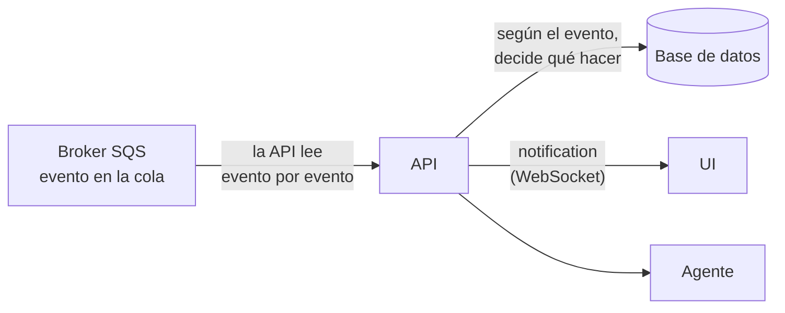
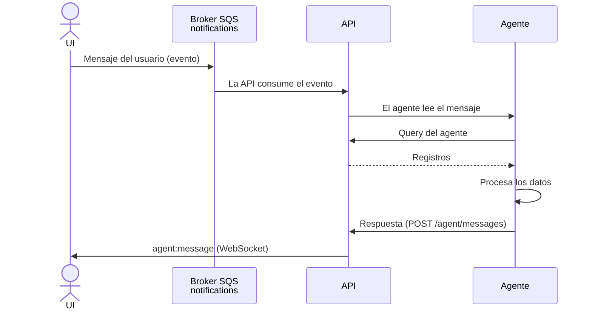
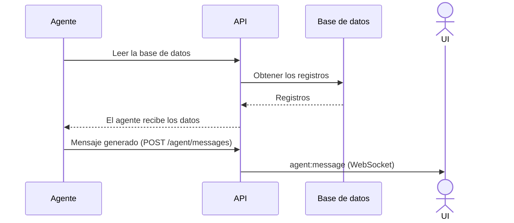

# Hack Saltillo API

API de inventario del reto de almacén inteligente para taller. Consume los eventos del taller desde
AWS SQS, los guarda y proyecta en PostgreSQL (libro mayor de existencias, reservas, faltantes y
reabasto), publica sus propios eventos de inventario, expone una API REST para el agente y es el servidor
de WebSocket con el que la UI se entera de los cambios en tiempo real.

- **Framework:** NestJS 12 (TypeScript, ESM) y TypeORM.
- **Broker:** AWS SQS (colas FIFO).
- **Base de datos:** PostgreSQL. El esquema lo crea Liquibase en `hack-saltillo-db`; la API no crea ni altera tablas.
- **Diseño:** [docs/API Design.md](docs/API%20Design.md).

## Contenido

1. [Correr la API en local](#correr-la-api-en-local)
2. [Scripts](#scripts)
3. [Variables de entorno](#variables-de-entorno)
4. [Flujo de información](#flujo-de-información)
5. [Colas SQS](#colas-sqs)
6. [Procesamiento de eventos](#procesamiento-de-eventos)
7. [Eventos de salida](#eventos-de-salida)
8. [Rutas HTTP](#rutas-http)
9. [WebSocket](#websocket)
10. [Convenciones de la API](#convenciones-de-la-api)
11. [Pruebas](#pruebas)
12. [Despliegue](#despliegue)

## Correr la API en local

### Requisitos

- Node.js 24.15 o superior y npm. Probado con 25.9: el CLI de Nest muestra un aviso `EBADENGINE` en esa
  versión, pero funciona.
- Docker, para la base de datos local.
- Acceso a AWS con permisos sobre las colas SQS (ver [Colas SQS](#colas-sqs)). Las pruebas locales usan
  las colas reales, no un emulador.

### Pasos

1. **Levantar la base de datos** (repositorio `hack-saltillo-db`). Liquibase aplica el esquema y los datos de ejemplo:

   ```bash
   cd ../hack-saltillo-db
   cp .env.example .env
   docker compose up -d
   ```

   PostgreSQL queda en `localhost:5432` con base, usuario y contraseña `inventario`.

2. **Configurar el entorno de la API.** Copia la plantilla y completa los valores con la tabla de
   [Variables de entorno](#variables-de-entorno):

   ```bash
   cp .env.example .env.local
   ```

3. **Instalar dependencias y arrancar:**

   ```bash
   npm install
   npm run start:dev
   ```

4. **Comprobar que responde** en el puerto 8000:

   ```bash
   curl http://localhost:8000/health
   ```

5. **Generar eventos.** El simulador del taller publica los eventos en las colas de entrada y la API los
   consume en cuanto llegan.

## Scripts

Cada script de arranque carga su propio archivo de entorno con `node --env-file`.

| Script | Archivo de entorno | `NODE_ENV` | Descripción |
|---|---|---|---|
| `npm run start` | `.env.local` | `local` | Compila y arranca. |
| `npm run start:dev` | `.env.local` | `local` | Modo observación: recompila al guardar. |
| `npm run start:debug` | `.env.local` | `local` | Observación con el depurador de Node. |
| `npm run start:prod` | `.env` | `dev` | Arranca el build de `dist/` (requiere `npm run build`). |
| `npm run build` | | | Compila a `dist/`. |
| `npm run test` | | | Pruebas unitarias (Vitest). |
| `npm run test:e2e` | | | Pruebas end-to-end. |
| `npm run test:cov` | | | Pruebas con cobertura. |
| `npm run lint` | | | Oxlint sobre `src/` y `test/`. |
| `npm run format` | | | Prettier. |

`.env.local` y `.env` no se versionan. `.env.example` documenta todas las variables con placeholders.

## Variables de entorno

| Variable | Valor local | Descripción |
|---|---|---|
| `NODE_ENV` | `local` / `dev` | `local` en `.env.local`, `dev` en `.env`. |
| `PORT` | `8000` | Puerto HTTP. Las pruebas de contrato esperan el 8000. |
| `CORS_ORIGIN` | `http://localhost:5173` | Origen de la UI. Es el único al que se permite CORS (HTTP y WebSocket). |
| `DATABASE_HOST` | `localhost` | En ECS, el endpoint del RDS compartido. |
| `DATABASE_PORT` | `5432` | |
| `DATABASE_NAME` | `inventario` | |
| `DATABASE_USER` | `inventario` | |
| `DATABASE_PASSWORD` | `inventario` | |
| `DATABASE_SSL` | `false` | `true` contra RDS. |
| `AWS_REGION` | | Región de las colas. |
| `AWS_ACCESS_KEY_ID` | | Solo para correr fuera de AWS. En ECS se deja vacía: se usa el rol de la tarea. |
| `AWS_SECRET_ACCESS_KEY` | | Ídem. |
| `SQS_SHOP_CATALOG_URL` | | URL de `inventory-broker-shop-catalog.fifo`. |
| `SQS_SHOP_WORK_ORDERS_URL` | | URL de `inventory-broker-shop-work-orders.fifo`. |
| `SQS_SHOP_INSPECTIONS_URL` | | URL de `inventory-broker-shop-inspections.fifo`. |
| `SQS_SHOP_PURCHASING_URL` | | URL de `inventory-broker-shop-purchasing.fifo`. |
| `SQS_NOTIFICATIONS_URL` | | URL de `inventory-broker-notifications.fifo`. |
| `SQS_INVENTORY_EVENTS_URL` | | URL de `inventory-broker-inventory-events.fifo`. |
| `SQS_INVENTORY_DLQ_URL` | | URL de `inventory-broker-inventory-dlq.fifo`. |
| `AGENT_URL` | | URL del agente. |

## Flujo de información

La API recibe los cambios a través de eventos que consume de SQS. El agente habla con la API por REST
(HTTP) y la API habla con la UI por WebSocket. Hay tres flujos.

### Evento

El simulador deja el evento en SQS. La API lo lee evento por evento y, según su `event_type`, decide qué
hacer y qué endpoint usar.



### Pregunta del agente

El mensaje del usuario en la UI genera un evento en la cola de notificaciones. La API lo consume y,
según su tipo, decide qué hacer.



### Lectura automática de la base de datos

El agente consulta por su cuenta, cada hora simulada (cada 10 minutos reales).



## Colas SQS

Una cola FIFO por cada tópico del simulador, más la de notificaciones. Son FIFO porque el contrato pide
orden por llave: el `key` del evento viaja como `MessageGroupId` y el `event_id` como
`MessageDeduplicationId`. La deduplicación basada en contenido está desactivada, así que cada envío lleva
su `MessageDeduplicationId`.

| Cola | Dirección | Eventos | `key` |
|---|---|---|---|
| `inventory-broker-shop-catalog.fifo` | entrada | `part.upserted`, `location.upserted`, `bom.upserted` | `part:305`, `location:14`, `model:4` |
| `inventory-broker-shop-work-orders.fifo` | entrada | `work_order.opened`, `.stage_changed`, `.deleted` | código de orden (`R061026012`) |
| `inventory-broker-shop-inspections.fifo` | entrada | `inspection.submitted`, `.approved`, `.rejected`, `.discarded`, `.voided` | código de orden |
| `inventory-broker-shop-purchasing.fifo` | entrada | `purchase.item_received` | `PR-` + `request_number` |
| `inventory-broker-notifications.fifo` | entrada | Eventos que genera el mensaje del usuario al agente; la API decide según su `event_type` | |
| `inventory-broker-inventory-events.fifo` | salida | `stock.*` | ver [Eventos de salida](#eventos-de-salida) |
| `inventory-broker-inventory-dlq.fifo` | salida | Evento original que no se pudo procesar | la del original |

La API consume solo las colas de entrada. Las de salida son para otros consumidores: en SQS cada mensaje
lo recibe un solo consumidor.

Garantías con las que está diseñada la API:

- **Al menos una vez:** pueden llegar duplicados. `event_inbox.event_id` es llave primaria y reprocesar un
  evento no cambia nada ni emite salidas.
- **Orden solo por llave** dentro de una cola. No hay orden entre colas.
- **Sin offsets:** SQS no guarda la posición del consumidor. Un mensaje solo se borra de la cola después de
  guardarse en la base, así que si la API se desconecta retoma con lo que quedó pendiente. El historial
  completo de lo consumido vive en `event_inbox`.

## Procesamiento de eventos

Todos los eventos usan el mismo sobre:

```json
{ "event_id": "uuid", "event_type": "inspection.approved", "event_version": 1,
  "occurred_at": "2026-10-06T16:42:11Z", "source": "shop-floor", "key": "R061026012", "data": {} }
```

Por cada mensaje:

1. Se valida el sobre contra el JSON Schema del contrato. Si es inválido o el `event_type` es desconocido,
   va a `dead_letter_event` y a `inventory-broker-inventory-dlq.fifo`.
2. **Dedup:** si el `event_id` ya está en `event_inbox` con `status = 'processed'`, se descarta.
3. En una transacción, con candados por pieza y por orden, se guarda el sobre completo en `event_inbox`.
4. Se ejecuta la función del `event_type`: escribe las tablas de dominio y encola las salidas en `outbox_event`.
5. El evento queda `processed` y se hace `COMMIT`.
6. Se borra el mensaje de SQS.

Si falta una dependencia (por ejemplo, una inspección que llega antes de su orden), el evento no se
descarta: queda en `event_inbox` como `failed`, no detiene el consumo y se reintenta cuando llega lo que
falta. Pasado el límite de intentos va a `dead_letter_event` y a la DLQ.

Al arrancar, y siempre que se reconstruya desde cero, la API vacía primero `inventory-broker-shop-catalog.fifo` antes de
leer las demás colas, para que las compras no lleguen antes que sus piezas.

### Qué escribe cada evento

| Evento | Escribe |
|---|---|
| `part.upserted` | `unit` y `part`. |
| `location.upserted` | `location`. |
| `bom.upserted` | `model` y `model_line`. Las líneas que ya no vienen pasan a `active = FALSE`. |
| `work_order.opened` | `work_order`. No pisa `stage` ni `deleted` si ya existía. |
| `work_order.stage_changed` | `work_order.stage` y `work_order_stage`. |
| `work_order.deleted` | `work_order.deleted`; libera reservas y cierra faltantes. |
| `inspection.submitted` | `inspection` e `inspection_item`. No mueve inventario. |
| `inspection.approved` | Lo anterior, más la necesidad: reservas, faltantes y sugerencias. Es la única que genera necesidad. |
| `inspection.rejected` / `.discarded` | `inspection.status`. |
| `inspection.voided` | `inspection.status`; libera reservas y cierra faltantes de esa inspección. |
| `purchase.item_received` | `purchase_request` y `purchase_line`; si es `restock`, entrada de inventario. |

### Reglas de negocio

- **Existencias:** `movement` es la fuente de verdad y `stock_balance` es una proyección. `available = on_hand - reserved`
  no baja de 0 por reservas ni salidas; solo `POST /counts` puede dejarlo negativo.
- **Necesidad:** solo los items de inspección con `action = 'buy'` generan necesidad, por `(orden, bom_line_id)`.
  Una nueva aprobación **reemplaza** la cantidad, no la suma.
- **Reserva y faltante:** se reserva `min(disponible, necesidad)` y el resto queda como faltante.
- **Compras:** `restock` se relaciona con `part.sku_norm` (sin mayúsculas ni espacios) y entra a la ubicación
  `U-100` (`location_id = 100`); además surte faltantes abiertos. `customer_order` se ignora. Sin pieza única,
  queda en `unmatched_receipt` para resolverse a mano.
- **Reabasto:** `stock.reorder_suggested` solo se emite cuando la sugerencia nace o cambia.

### Unidades físicas

El estado y la reparación son de cada **unidad física**, no del tipo de pieza. Dos motores iguales son dos
registros independientes en `part_instance`, cada uno con su propio estado, ubicación, orden de trabajo,
número de serie y receta de reparación:

- Motor 1: defectuoso, le falta la banda; necesita llave Allen y prensa.
- Motor 2: defectuoso, le falta un tornillo; necesita llave Allen y torquímetro.

Las herramientas de cada unidad viven en `part_instance_repair_tool`, los repuestos que le faltan en
`part_instance_repair_component` y sus cambios de estado en `part_status_history`. Las unidades son una
capa aparte del inventario: no modifican `movement` ni `stock_balance`, la existencia sigue siendo por cantidad.

## Eventos de salida

Mismo sobre, con `source = "inventory"`, `event_version = 1` y un `event_id` nuevo. Se encolan en
`outbox_event` dentro de la misma transacción que el cambio y un publicador los envía a
`inventory-broker-inventory-events.fifo` (entrega al menos una vez).

| Evento | `key` | Cuándo |
|---|---|---|
| `stock.received` | `part:<part_id>` | Entrada en `U-100`, o al resolver una recepción. |
| `stock.unmatched_receipt` | `purchase_line:<line_id>` | Compra `restock` sin pieza única. |
| `stock.reserved` | código de orden | Por cada reserva, también al surtir un faltante. |
| `stock.shortage_detected` | código de orden | Nace o cambia un faltante. |
| `stock.shortage_resolved` | código de orden | Una entrada surte un faltante. |
| `stock.issued` | código de orden | `POST /issues`. |
| `stock.transferred` | `part:<part_id>` | `POST /transfers`. |
| `stock.adjusted` | `part:<part_id>` | Una por línea con diferencia en `POST /counts`. |
| `stock.reorder_suggested` | `part:<part_id>` | Nace o cambia la sugerencia. |

## Rutas HTTP

### Contrato

| Método y ruta | Respuesta | Descripción |
|---|---|---|
| `GET /parts/{part_id}/availability` | 200 / 404 | Existencia total y por ubicación (`on_hand`, `reserved`, `available`). |
| `GET /parts/{part_id}/ledger` | 200 / 404 | Kardex: movimientos con el saldo después de cada uno. |
| `GET /work-orders/{code}/materials` | 200 / 404 | Por línea de la orden: `required`, `reserved`, `issued`, `missing`. |
| `GET /shortages?work_order_code=&part_id=` | 200 | Faltantes abiertos. |
| `GET /reorder-suggestions` | 200 | Sugerencias de reabasto. |
| `GET /unmatched-receipts` | 200 | Recepciones sin relacionar. |
| `POST /unmatched-receipts/{id}/resolve` | 200 / 404 / 409 | Relaciona una recepción con una pieza (`{part_id, location_id?}`). 409 si ya estaba resuelta. |
| `POST /issues` | 201 / 404 / 409 | Salida de material (`{work_order_code, part_id, location_id, quantity, issued_by}`). 409 si no alcanza. |
| `POST /transfers` | 201 / 404 / 409 / 422 | Transferencia entre ubicaciones. Origen igual a destino da 422. |
| `POST /counts` | 201 / 404 / 422 | Conteo físico (`{location_id, reason, lines:[{part_id, counted_quantity}]}`). Sin `reason` da 422. |

### Extensión

| Método y ruta | Descripción |
|---|---|
| `GET /events?source=&type=&status=&topic=&limit=` | Lista lo consumido y lo generado: `event_inbox` (`source=inbox`), `outbox_event` (`source=outbox`) y `dead_letter_event` (`source=dlq`). Solo lectura. |
| `POST /agent/messages` | El agente entrega el mensaje que generó (`{message, data?}`) y la API se lo manda a la UI por WebSocket (`agent:message`). Responde 202. |
| `POST /purchase-orders` | Crea una orden de compra: `purchase_request`, `purchase_order` y `purchase_line`. No emite eventos `stock.*`. |
| `PATCH /parts/{part_id}` | Modifica la política de reabasto del tipo de pieza (`reorder_policy`: mínimo, máximo, cantidad de reorden y lead time). Las columnas de `part` vienen de `part.upserted` y no se parchean. |
| `GET /parts?q=&sku=&condition=&available=` | Busca tipos de pieza (`v_part_agent_summary`): existencia y cuántas unidades hay en cada estado. |
| `GET /parts/{part_id}` | Detalle de un tipo de pieza. |
| `GET /part-instances?part_id=&condition=&work_order_code=` | Unidades físicas (`v_part_instance_agent`) con su estado, ubicación, orden, serie, herramientas (`tools`) y repuestos faltantes (`missing_components`). |
| `GET /part-instances/{instance_id}` | Detalle de una unidad física. |
| `PATCH /part-instances/{instance_id}` | Modifica una unidad física (`condition_code`, `location_id`, `work_order_id`, `serial_number`, `note`). Cada cambio de estado queda en `part_status_history`. |
| `GET /suppliers` | Proveedores. |
| `GET /work-orders` y `GET /work-orders/{code}` | Órdenes de trabajo y su historial de etapas. |
| `GET /health` | Estado de la API: base de datos, eventos pendientes en `event_inbox` y `outbox_event` sin publicar. |

## WebSocket

La API es el servidor de WebSocket (socket.io, en el mismo puerto `8000`). La UI se conecta con
`socket.io-client`:

```js
import { io } from 'socket.io-client';

const socket = io('http://localhost:8000');
socket.on('notification', (event) => { /* nueva alerta: event.event_type, event.data */ });
socket.on('agent:message', (msg) => { /* mensaje del agente: msg.message */ });
socket.emit('parts:list', { q: 'motor' }, ({ items }) => { /* productos */ });
```

| Mensaje | Dirección | Contenido |
|---|---|---|
| `notification` | API → UI | Sobre del evento (`event_id`, `event_type`, `occurred_at`, `key`, `data`, …). Llega por cada evento `stock.*` que genera la API y por cada evento que consume de SQS. |
| `agent:message` | API → UI | `{message, data, received_at}`: lo que el agente entregó en `POST /agent/messages`. |
| `parts:list` | UI → API, con respuesta | Mismos filtros que `GET /parts`; responde `{items}`. |

Las notificaciones salen solo después de guardar el cambio en la base. Una UI desconectada no recibe lo
que pasó mientras tanto: al reconectar vuelve a pedir los datos.

## Convenciones de la API

- JSON UTF-8. Un `part_id` que no es entero responde 404.
- Errores: `{"detail": "..."}`. Validación del cuerpo fallida: **422**.
- Listas: `{"items": [...]}`.
- Importes como texto decimal (`"1850.00"`), cantidades enteras y fechas ISO 8601 UTC terminadas en `Z`.
- Sin autenticación por ahora. Las rutas del contrato nunca la llevarán.
- CORS permitido solo para el origen de la UI (`CORS_ORIGIN`).
- TypeORM con `synchronize: false`. Las columnas generadas (`part.sku_norm`, `stock_balance.available`) son
  de solo lectura y las vistas (`v_part_availability`, `v_part_agent_summary`, `v_part_instance_agent`, `v_open_shortages`,
  `v_unmatched_receipts`, `v_reorder_suggestions`, `v_part_ledger`) también.

## Pruebas

```bash
npm run test        # unitarias
npm run test:e2e    # end-to-end
npm run test:cov    # cobertura
```

Las pruebas de contrato del kit (`hackathon-inventario-kit`) se corren con la API en el puerto 8000:

```bash
docker compose run --rm contract-tests --api http://host.docker.internal:8000
```

Conviene correr **un solo** servicio de inventario mientras se prueba: las pruebas leen toda la cola
`inventory-broker-inventory-events.fifo`.

## Despliegue

La API se despliega en AWS ECS. La base de datos vive en un RDS compartido y las credenciales de SQS salen
del rol de la tarea, no de variables de entorno.
